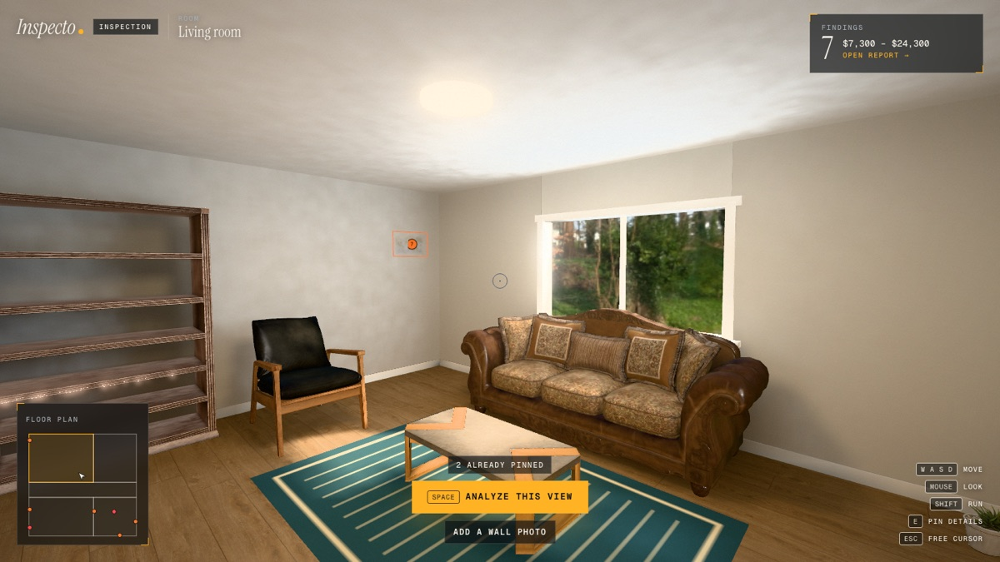
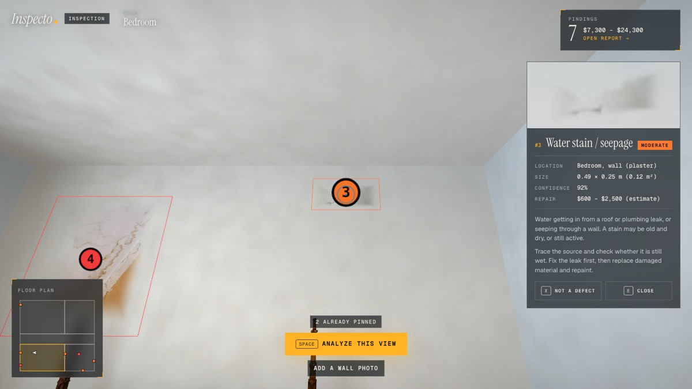

# Inspecto

Photograph a wall, and a vision model running on your own laptop finds the damage (cracks,
mold, water stains, peeling paint, scuffs, holes), measures it and prices the repair. Nothing
is uploaded and nothing costs money.

**It is visual triage, not a licensed inspection.** It can miss damage and name it wrongly,
it cannot see behind walls, and its repair prices are rough estimates, not quotes.

**Live demo:** https://inspecto-tau.vercel.app (the 3D walkthrough only). The Python server is
not connected there yet, so photo analysis, floor plans and saved inspections need a local run
(below). It can be connected easily: host the server anywhere that runs Docker and forward
`/api` to it from Vercel.

*Both screenshots are from a real run: every pin was placed by the trained detector, not by hand.*

## What you can do with it

| Page | Address | What it is for |
|---|---|---|
| Condition reports | `/inspect.html` | Photograph each wall when a tenant moves in, retake the same views when they leave. New damage is marked and priced; you confirm or correct every item; print the result. |
| Check a photo | `/photo.html` | Drop in photos of a wall and get a verdict and a running repair total. |
| 3D home | `/` | Walk a demo apartment, press Space to analyze a view, pin what is found, read the report. A real photo can be hung on a wall with `P`. |
| Report | `/report.html` | The 3D home's findings by room, with a suggested offer adjustment. |

Prices can be set for a location (three test areas so far: New York City metro,
Trenton-Princeton NJ, Scranton-Wilkes-Barre PA). iPhone photos work, including HEIC.

## Run it

Needs macOS on Apple silicon, [uv](https://docs.astral.sh/uv/) and Node 20 or newer.

    uv sync                                          # Python side, once
    brew install tesseract                           # reads lengths on floor plans, once
    npm --prefix web install                         # web side, once
    uv run uvicorn server.app:app --port 8000        # the detector (first terminal)
    npm --prefix web run dev                         # the app (second terminal)

Then open http://localhost:5173. The server needs the trained model at `models/detector.pth`.
It is not in git: [download it from the release](https://github.com/Ekagraj/Inspecto/releases/download/model-v1/detector.pth)
(121 MB) and put it in `models/`, or train your own as below.

**From a phone on the same Wi-Fi:** start the app with `npm --prefix web run dev:phone`
instead and open the "Network" address it prints. Adding a photo opens the phone's camera.
"Use my current location" does not work this way (browsers only allow it on a secure
connection), so type the place instead. Anyone on that Wi-Fi can open the app while it runs.

## Test it

Both servers must be running. Tests drive a real browser and the real detector.

    cd web
    node tests/inspect.mjs out      # condition reports: move-in, move-out, corrections, print
    node tests/photo.mjs out        # photo page: real photos, HEIC, location pricing, errors
    node tests/report.mjs out       # 3D home report: totals, offer maths, location, print
    node tests/wallphoto.mjs out    # a real photo hung in the 3D home
    node tests/smoke.mjs out        # 3D home: rooms, collision, one real detection
    node tests/pins.mjs out         # 3D pinning accuracy
    node tests/detect-eval.mjs 3 20 # detector precision / recall inside the 3D home

    cd .. && uv run python -m server.compare && uv run python -m server.inspections

## How good is the detector?

| Test set | Precision | Recall |
|---|---|---|
| Rendered inspection views inside the 3D apartment (3 homes, 67 planted defects) | 90% | 81% |
| Real photos never seen in training (original dataset, 225 photos) | 95% | 89% |
| Harder real photos from eight other datasets (784 photos) | 61% | 31% |

All rows use the released model ([`detector.pth`](https://github.com/Ekagraj/Inspecto/releases/tag/model-v1), seven damage types). Confidence threshold 0.4, IoU 0.5. The first row flatters the model, because those views reuse
training images. The last row is the real gap: mold and water stains are often confused with
each other, and scuffs and holes have little training data.

To reproduce the real-photo rows, run `uv run ml/evaluate.py`. It writes a per-class
breakdown to `results/eval.md`.

## Train it

    uv run ml/get_data.py                # the original real photos (46 MB)
    python3 ml/get_roboflow.py           # eight more public sets (633 MB); needs a free
                                         # Roboflow API key in a file named .roboflow_key
    uv run ml/prep_extra.py              # map their classes onto ours, drop duplicates
    nohup caffeinate -is sh ml/train_more.sh > train_more.log 2>&1 &

Training takes about 3 to 3.5 hours on an M3, plugged in with the lid open. It keeps the
previous model as `models/detector_before_extra.pth`. Never run two trainings at once.

## How it works, briefly

- **Detector:** RF-DETR Nano, fine-tuned on real photos plus rendered views of the 3D home
  with real defect cut-outs on its walls. Seven classes (`ml/classes.py`).
- **Size and severity:** in the 3D home, from where the boxes land on the walls. On a photo,
  from the width you say the photo covers. Severity and price come from size and type
  (`web/src/costs.json`), not from the image.
- **Before / after:** the move-out photo is lined up with the move-in photo from their
  shared detail (`server/compare.py`). Plain walls often cannot be lined up; the app then
  says so and asks you to decide.
- **Local prices:** the cost table times the local mean wage of painters over the US mean.

`ARCHITECTURE.md` has the full design.

## Credits and licences

- Code: three.js, Vite, FastAPI, Playwright (MIT / Apache 2.0); RF-DETR and its weights,
  PyTorch, Pillow, OpenCV, matplotlib (Apache 2.0 / BSD / HPND).
- Training photos, all CC BY 4.0 from Roboflow Universe: `objectdetection-qxiqx/detr_crack_dataset`,
  `dommages/batch1-yprx8`, `dommages/batch2-eunzt`, `scipublic/wall-6bnve`,
  `peumalab/wall-defects`, `assuralabs/av-water-damage`,
  `elaas-workspace/wall-defect-7fdkt-jpjpa`, `jq3/building_defect`,
  `building-fault-detection-and-diagnostics/paint-damage-det`.
- Textures, furniture and sky in the 3D home: CC0, Poly Haven.
- Wage data for local prices: US Bureau of Labor Statistics, Occupational Employment and
  Wage Statistics, May 2025 (public domain).
